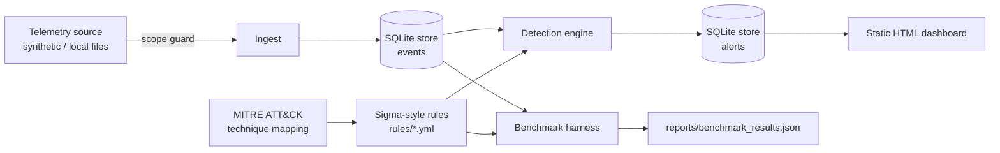

# home-lab-soc

A lightweight, fully offline **Security Operations Center** for a home lab: log
ingestion → a SQLite-backed mini-SIEM → Sigma-style detection rules mapped to
**MITRE ATT&CK** → alerting → a static dashboard, plus a seeded benchmark that
reports **per-rule detection rate and false positives** on labeled telemetry.

## What it is

A small, readable detection pipeline you can run end-to-end with one command and
no external services. It ships nine detection rules, a synthetic attack-telemetry
generator with ground-truth labels, a detection engine, a SQLite store, an HTML
dashboard, and a benchmark harness. Every number in this README is produced by
the committed code against the committed dataset — nothing is hand-entered.

## Why

SOC/detection skills are best shown, not claimed. Most "SOC lab" write-ups stop
at "I installed the stack." This repo instead makes the detections **measurable**:
rules are scored against labeled data, so you can see what each rule catches and
what it would miss. It is intentionally dependency-light (PyYAML + pytest) so the
logic is the point, not the plumbing.

## Architecture



## How it works

- **Scope guard (`soc/scope.py`)** — every ingest path calls
  `assert_source_allowed`. Only local/synthetic sources (`localhost`, loopback
  IPs, `file://`, local paths, the `synthetic` pseudo-source) are accepted;
  external hosts are refused. This SOC never reaches out to third-party systems.
- **Rules (`rules/*.yml`, `soc/rules.py`)** — a tested subset of Sigma: field
  modifiers `contains / startswith / endswith / re`, list-as-OR, selection-as-AND,
  and `condition` forms (`sel`, `a and not b`, `all of them`, `1 of them`). Each
  rule carries its ATT&CK tactic + technique id.
- **Engine (`soc/engine.py`)** — evaluates every stored event against all rules
  and writes alerts (rule, level, technique, evidence) to SQLite.
- **Telemetry (`soc/telemetry.py`)** — deterministic (`seed=1337`) Windows
  Sysmon/Security-shaped events. Public datasets (Mordor / OTRF
  Security-Datasets) require large network downloads; this synthetic generator
  keeps the repo offline and reproducible while mirroring their event shape.
  Malicious events are labeled with the rule id they should trip (ground truth).
- **Benchmark (`soc/benchmark.py`)** — scores detection rate per rule and counts
  benign false positives.

Run it:

```bash
pip install -r requirements.txt
python scripts/run_pipeline.py     # ingest -> detect -> reports/dashboard.html
python scripts/benchmark.py        # -> reports/benchmark_results.json
pytest -q                          # 19 tests
```

## Results

Measured by `scripts/benchmark.py` on the seeded synthetic dataset
(`reports/benchmark_results.json`, seed=1337):

| Metric | Value |
|---|---|
| Events scored | 580 |
| Malicious (labeled) | 180 |
| Malicious detected | 180 |
| **Overall detection rate** | **100.0%** |
| Benign events | 400 |
| **Benign false positives** | **0 (0.0%)** |
| Detection rules | 9 |

Per-rule detection rate is **1.0** for all nine techniques on this dataset
(T1059.001, T1059.003, T1003.001, T1053.005, T1547.001, T1105, T1218.011,
T1486, T1110). Full breakdown in `reports/benchmark_results.json`; `pytest`
asserts both the 100% family-detection and the 0-false-positive properties so
they can't silently regress.

**Honest reading of these numbers:** 100% / 0 FP is expected here because the
rules and the synthetic attack events were authored in the same repo — this
measures *rule correctness and the scoring harness*, not real-world efficacy
against evasive attackers or noisy production logs. It is a regression gate and a
demonstration of method, not a claim that these rules catch real intrusions at
100%. See Limits.

## Limits / ethics & scope

- **Lab-only, local-only.** The scope guard refuses any non-local telemetry
  source. This project ingests and analyzes logs; it does not scan, probe, or
  attack anything.
- **Synthetic data.** Numbers come from generated telemetry, not a real network.
  Swapping in real lab logs (or replayed Mordor datasets) would change — and
  realistically lower — the detection rate; the harness is built to surface that.
- **Not a production SIEM.** No log shipping at scale, no auth, no retention
  policy, no alert dedup/aggregation beyond single-event rules (the 4625
  brute-force case is flagged per-event; true aggregation is noted as future
  work). Use real tooling (OpenSearch, Elastic, Wazuh) for production.
- **Docker note.** A container-based collector (Vector/Fluent Bit → OpenSearch)
  was in scope but Docker was unavailable in the build environment, so the
  SQLite mini-SIEM path is what ships and is tested.

## License

MIT — see [LICENSE](LICENSE).
